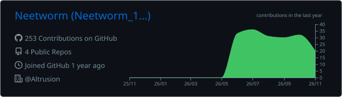
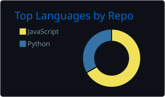
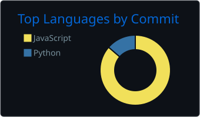
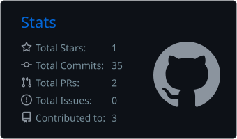
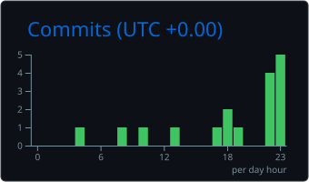

<div align="center" id="top">

  

  <h3>Software Engineer | Full-Stack & AI-Native Developer</h3>

  

  <p>
    📍 Ghaziabad, Uttar Pradesh, India · 🎓 B.Tech CSE '26
  </p>

  <a href="mailto:garvitghai880@gmail.com">
    
  </a>
  <a href="https://www.linkedin.com/in/garvit-ghai-80638828a">
    
  </a>
  <a href="https://leetcode.com/u/LuffyD2001/">
    
  </a>
  <a href="https://www.hackerrank.com/garvitghai">
    
  </a>

  <br/><br/>

  

</div>

---

## 👨‍💻 ABOUT ME

```yaml
name: Garvit Ghai
role: Full-Stack & AI-Native Software Engineer
education: B.Tech Computer Science Engineering (2026)
availability: Available For Immediate Joining

focus:
  - Full-Stack Development
  - Real-Time Collaborative Systems
  - AI-Powered Applications
  - Backend Architecture & APIs

featured_work:
  - CodeCollab: Real-time collaborative cloud IDE
  - ElevateU+: AI-powered resume intelligence platform

currently_interested_in:
  - Scalable Backend Systems
  - Cloud Infrastructure
  - AI Integration
```

### ⚙️ ENGINEERING FOCUS

| Area | What I Build |
|---|---|
| Full-Stack Engineering | End-to-end applications with modern frontend and backend stacks |
| Real-Time Systems | Collaborative applications using WebSockets and Socket.IO |
| AI-Native Development | Intelligent applications integrating AI models and APIs |

---

## 🛠️ TECH STACK

<div align="center">

**Languages & Frontend**


**Backend & Databases**


**Cloud, DevOps & Tools**


</div>

**Also familiar with:** Cursor, GitHub Copilot, Claude, CI/CD, Socket.IO, REST APIs, JWT, OAuth.

---

## 🚀 FEATURED PROJECTS

### 1. CodeCollab — Real-Time Collaborative Cloud IDE

A collaborative cloud-based coding environment designed for real-time teamwork.

- Built real-time code synchronization with sub-150ms WebSocket sync.
- Integrated Docker-based isolated code execution for JavaScript, Python, C++ and Java.
- Implemented GitHub OAuth, JWT authentication and account merging.
- Used MongoDB Atlas and AWS S3 for data and file management.

[🌐 Live Demo](https://collaborative-ide-six.vercel.app/) · [📂 Source Code](https://github.com/Neetworm/CollaborativeIDE)

### 2. ElevateU+ — AI-Powered Resume Intelligence

An AI-powered career assistant that helps users evaluate and improve resumes.

- Built a full-stack application using React, Node.js and Express.
- Integrated AI-powered resume analysis and scoring.
- Used MySQL with indexed queries for efficient data retrieval.
- Implemented secure authentication using JWT.

[📂 Source Code](https://github.com/Neetworm/ElevateUplus)

---

## 💼 EXPERIENCE

### Full Stack Developer Intern — Altrusian Computer
**April 2026 – September 2026 | Remote**

- Developed production-oriented frontend features using React.
- Built backend services and REST APIs using Node.js and Express.
- Implemented request validation, error handling and backend logic.
- Worked on query optimization and application performance.
- Collaborated in an Agile development environment.

---

<!--
## 🏆 GITHUB TROPHIES

<div align="center">


</div>

---
-->

## 🔥 GITHUB STREAK

<div align="center">


</div>

---

## 📊 GITHUB ANALYTICS

<div align="center">

  

  <br/>

  

  

  <br/>

  

  

</div>

---

## 📈 CONTRIBUTION ACTIVITY

<div align="center">


</div>

---

## 🐍 CONTRIBUTION SNAKE

<div align="center">


</div>

---

<div align="center">

### 💡 ENGINEERED FOR SPEED. BUILT TO SCALE.

**Let's connect and build something great.**

<a href="#top">
  
</a>

<br/><br/>

<sub>Designed & Built by Garvit Ghai · Keep Building. Keep Shipping. 🚀</sub>

</div>
